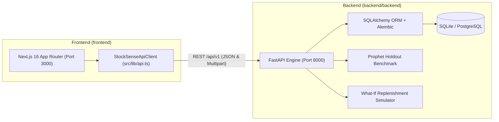

# StockSense — Unified End-to-End System

**StockSense** integrates an explainable operations research & machine learning backend (**FastAPI + SQLAlchemy + Prophet**) with a real-time reactive supply chain intelligence frontend (**Next.js 16 + React 19 + Tailwind CSS + Recharts + GSAP**).

---

## Architecture Overview



---

## Services & Ports

| Service | Directory | Tech Stack | Local URL |
|---|---|---|---|
| **Backend API** | `backend/backend` | Python 3.11, FastAPI, SQLAlchemy, Alembic, Prophet | `http://127.0.0.1:8000` (`/api/v1`) |
| **API Docs (Swagger)** | `backend/backend` | OpenAPI / Swagger UI | `http://127.0.0.1:8000/docs` |
| **Frontend Web App** | `frontend` | Next.js 16 (Turbopack), React 19, TypeScript, Tailwind CSS | `http://localhost:3000` |

---

## Quickstart

### 1. Backend Setup & Startup
```bash
# Navigate to the FastAPI backend directory
cd backend/backend

# Activate the Python 3.11 virtual environment
source .venv/bin/activate

# Apply database schema migrations
alembic upgrade head

# Start the development server with auto-reload
uvicorn app.main:app --host 127.0.0.1 --port 8000 --reload
```

### 2. Frontend Setup & Startup
```bash
# Navigate to the frontend directory
cd frontend

# Start Next.js development server
npm run dev
```

### 3. Unified Workspace Commands
From the repository root (`Stock_Sense/`):
- `npm run dev:backend` — Launch the FastAPI backend on port 8000.
- `npm run dev:frontend` — Launch the Next.js frontend on port 3000.
- `npm run build:frontend` — Typecheck and build the frontend bundle.
- `npm run seed:backend` — Seed demo SKUs and 45-day historical demand records.
- `npm run migrate:backend` — Run Alembic database migrations.

---

## Live Integrated Capabilities

1. **Service Health & Connection Status**:
   - The TopBar displays real-time connectivity status to the live FastAPI backend via `/api/v1/health`.
   - Automatic fallback protects against crashes if the backend is temporarily offline.

2. **Product Catalog & Live Inventory Profiles**:
   - Fetches live products from `GET /api/v1/products`.
   - Supports creating new SKUs (`POST /api/v1/products`) and adjusting stock/lead time (`PATCH /api/v1/products/{id}`).

3. **Demand Intelligence & Historical Observations**:
   - Retrieves chronological transaction records via `GET /api/v1/products/{id}/demand`.
   - Supports two-phase transactional CSV imports:
     - `POST /api/v1/imports/preview`
     - `POST /api/v1/imports/{id}/confirm`

4. **Deterministic Replenishment Recommendations**:
   - Evaluates Safety Stock, Reorder Point, and EOQ adjustments with supplier MOQ and pack size rounding via `POST /api/v1/products/{id}/recommendations/calculate`.

5. **Statistical Anomaly Review**:
   - Runs deterministic Median/MAD outlier detection on product demand via `POST /api/v1/products/{id}/anomalies/detect`.
   - Human-in-the-loop review confirmation via `PATCH /api/v1/anomalies/{id}/review`.

6. **What-If Replenishment Simulator**:
   - Stress tests inventory availability against demand surges and supplier delivery delays via `POST /api/v1/products/{id}/scenarios`.

7. **Prophet vs. Moving Average Holdout Tournament**:
   - Executes chronological holdout accuracy benchmarks via `POST /api/v1/products/{id}/forecast-benchmark`.
