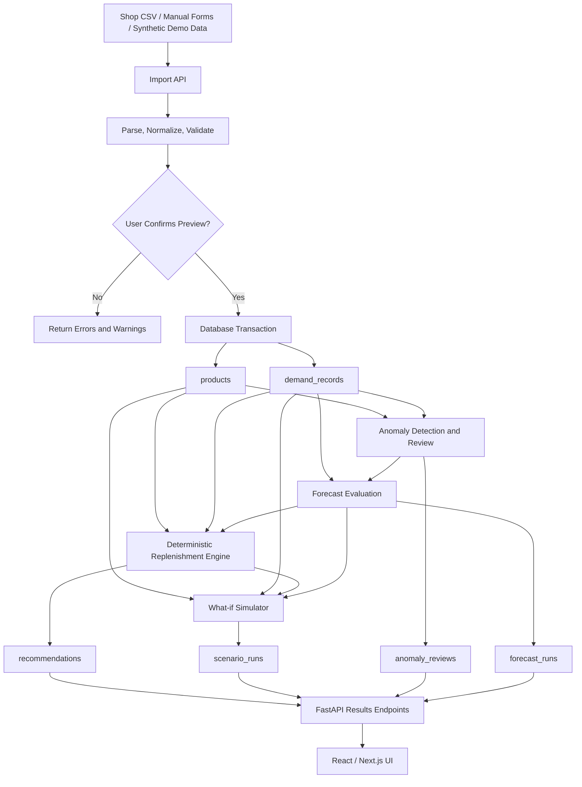

# StockSense Backend Plan: Data Assumptions, Input Formats, Preprocessing, Database Population, and Implementation

## 1. Purpose

This document defines the backend plan for **StockSense: Adaptive Inventory Replenishment Engine**. It explains what the system assumes about a shop's data, what information the shop must provide, how that information should be formatted, how it will be validated and preprocessed, how the finalized database schema will be populated, and how the backend services should be implemented.

The MVP must be a working, reproducible system—not a static dashboard. It should use deterministic inventory rules, preserve original records, clearly label assumptions, and remain usable with fictional/demo data when a real shop dataset is unavailable.

---

## 2. What We Are Assuming

The MVP needs a clear operating model. These are **product assumptions**, not claims that every shop already records data this way.

### 2.1 Shop and inventory assumptions

1. The initial target is a small or medium-sized retail shop.
2. Each product has a unique SKU (stock-keeping unit). The SKU is the stable identifier used to connect product information, sales history, anomalies, forecasts, and recommendations.
3. The shop can provide historical sales or demand records, ideally exported as CSV from a POS/billing system or maintained in a spreadsheet.
4. The MVP works primarily with **daily demand aggregated per product**. It does not require individual invoice-line data.
5. The shop can provide current on-hand stock for each product.
6. For the initial MVP, each product has one configured supplier or one effective lead-time profile. Multiple suppliers and supplier-selection optimization are out of scope.
7. Lead time can be provided as an average and, if available, a measure of variability. If variability is unknown, the application must show the assumption it uses rather than pretending the value is known.
8. Replenishment recommendations are advisory. The MVP does not automatically create or send purchase orders.
9. A real dataset is not required for the demo. The application must include a clearly labeled synthetic dataset that can exercise normal demand, spikes, zero-demand days, and supplier delays.
10. Forecasting, anomaly detection, replenishment calculations, and scenario simulation are separate services with separate outputs.

### 2.2 Historical data assumptions

- Daily sales quantities are a usable proxy for demand **only when stock availability is adequate**.
- If an item was out of stock, recorded sales may understate true demand. The system must retain stockout context rather than treating every zero-sales day as genuine zero demand.
- A missing date is not automatically a zero-sales day. It could mean no sales, missing records, a shop closure, or an import gap.
- An unusual value is an anomaly candidate, not proof of an error. Promotion spikes and genuine demand surges must not be automatically deleted or corrected.
- The system should keep raw observations unchanged. Any reviewed or adjusted value must be stored separately with its reason and review history.
- The system must not invent costs, supplier lead times, or other operational facts to make a recommendation appear complete.

### 2.3 MVP scope boundaries

Included:
- Product and inventory management
- Historical daily demand import and validation
- Anomaly detection and human review
- Forecast benchmark using a baseline and one candidate method
- Deterministic replenishment recommendation
- What-if simulation for demand surges and supplier delays
- Explanations, assumptions, and reproducible run history

Deferred:
- Automatic purchasing or ERP integration
- Multi-warehouse optimization
- Complex multi-supplier selection
- Perishable inventory logic
- Advanced role and approval workflows
- Mandatory cloud AI dependency
- Email alerts and elaborate 3D visualization

---

## 3. Required Shop Data and Input Formats

The simplest initial contract is to accept CSV files exported from a POS system or maintained in a spreadsheet. The UI should also allow manual entry for a small number of products.

### 3.1 File A: `daily_demand.csv` — historical demand

**One row represents one product's demand/sales quantity on one date.**

| Field | Required? | Type | Description |
|---|---|---|---|
| `sku` | Yes | String | Product identifier; must match a product in the product master |
| `date` | Yes | Date (`YYYY-MM-DD`) | Date of the daily observation |
| `units_sold` | Yes | Non-negative number | Quantity sold/recorded as demand for that SKU on that date |
| `stockout_flag` | Strongly recommended | Boolean | Whether the product was unavailable for some or all of that day |
| `promotion_flag` | Optional | Boolean | Whether a promotion was active |
| `notes` | Optional | String | Context such as holiday, closure, or known data issue |

Example:

```csv
sku,date,units_sold,stockout_flag,promotion_flag,notes
SKU-001,2026-09-01,12,false,false,
SKU-001,2026-09-02,15,false,false,
SKU-001,2026-09-03,48,false,true,festival promotion
SKU-001,2026-09-04,0,true,false,out of stock
SKU-001,2026-09-05,11,false,false,
SKU-002,2026-09-01,5,false,false,
SKU-002,2026-09-02,7,false,false,
```

Important interpretation:
- A row with `units_sold = 0` is an explicit observation. It is not the same as a date absent from the file.
- `stockout_flag = true` means the recorded quantity may be censored by availability and should be considered during analysis.
- A promotion spike should be preserved. The anomaly detector may flag it, but the application must not delete it automatically.

If the shop has transaction-level records, they can be aggregated into daily SKU totals during ingestion. The first version does not need invoice numbers, customer information, payment details, or personally identifying data.

### 3.2 File B: `products.csv` — product master and current inventory

**One row represents one product.**

| Field | Required? | Type | Description |
|---|---|---|---|
| `sku` | Yes | String | Unique product identifier |
| `product_name` | Yes | String | Human-readable product name |
| `unit_of_measure` | Yes | String | Unit such as `piece`, `pack`, or `kg` |
| `on_hand_qty` | Yes | Non-negative number | Current physical quantity available |
| `committed_qty` | Optional | Non-negative number | Quantity already committed/reserved for existing demand |
| `unit_cost` | Optional | Non-negative decimal | Purchase cost per unit, if known |
| `ordering_cost` | Optional | Non-negative decimal | Cost per order used by EOQ, if known |
| `holding_cost_per_unit_year` | Optional | Non-negative decimal | Annual holding cost per unit, if known |
| `target_service_level` | Optional | Fraction between 0 and 1 | Target cycle service level; default may be 0.95 and must be visible/editable |
| `minimum_order_qty` | Optional | Non-negative number | Supplier minimum order quantity |
| `pack_size` | Optional | Positive number | Order quantity must be a multiple of this value when applicable |

Example:

```csv
sku,product_name,unit_of_measure,on_hand_qty,committed_qty,unit_cost,ordering_cost,holding_cost_per_unit_year,target_service_level,minimum_order_qty,pack_size
SKU-001,Notebook,piece,80,5,25,100,4,0.95,10,5
SKU-002,Water Bottle,piece,24,0,90,100,12,0.95,6,2
```

Rules:
- `sku`, `product_name`, `unit_of_measure`, and `on_hand_qty` are required for the basic inventory workflow.
- Cost fields are optional. If EOQ or cost comparisons require a missing cost, the relevant calculation must be disabled or explicitly marked unavailable.
- If the service level is omitted, use the documented default only after displaying it to the user.
- If committed quantity is not tracked, use zero only as an explicit, disclosed assumption.
- Validate that `pack_size > 0` when provided and that quantities satisfy the shop's unit-of-measure convention.

### 3.3 File C: `supplier_settings.csv` — lead-time profile

**One row represents the lead-time configuration for one SKU in the MVP.**

| Field | Required? | Type | Description |
|---|---|---|---|
| `sku` | Yes | String | Product identifier |
| `average_lead_time_days` | Yes for recommendations | Positive number | Typical time between placing an order and receiving it |
| `lead_time_stddev_days` | Recommended | Non-negative number | Variability in supplier lead time |

Example:

```csv
sku,average_lead_time_days,lead_time_stddev_days
SKU-001,4,1.2
SKU-002,7,2
```

Lead-time values can be entered manually or estimated from historical purchase-order and goods-received dates if those records exist. If only an average is available, the system must label the lead-time-variability assumption; it must not silently treat unknown variability as measured fact.

### 3.4 Optional data sources

These can improve realism but are not required for the first demo:

| Data | Example fields | Why it helps |
|---|---|---|
| Incoming purchase orders | `sku`, `quantity`, `expected_arrival_date`, `status` | Helps calculate inventory position correctly |
| Historical orders and receipts | `sku`, `order_date`, `received_date`, `quantity` | Can estimate actual lead-time distribution |
| Backorders/reservations | `sku`, `quantity`, `status` | Helps estimate committed demand |
| Calendar/event data | `date`, `event_type`, `promotion_flag` | Adds context to demand changes |
| Lost-sales/stockout estimates | `sku`, `date`, `estimated_unmet_demand` | Helps distinguish low sales from unavailable stock |
| Supplier constraints | `sku`, `minimum_order_qty`, `pack_size` | Keeps proposed quantities operationally realistic |

Do not require every optional source to be present. The interface should identify which features are available based on the data actually supplied.

---

## 4. How the Shop Provides Data

Support three entry paths:

1. **CSV import:** recommended for historical sales and bulk product setup.
2. **Manual forms:** suitable for adding or correcting one product, its current stock, lead-time profile, and cost inputs.
3. **Built-in demo dataset:** fictional data for reliable judging and testing when the shop cannot provide records.

The demo dataset should be deterministic and versioned. It should include ordinary demand, a genuine spike, an explicit zero-demand day, a stockout-affected day, and a supplier-delay scenario. Clearly label it as synthetic so no one mistakes it for real shop data.

### 4.1 Recommended import workflow

Use a staged import rather than writing an uploaded file directly into production tables.

1. **Upload:** user chooses a file and its type.
2. **Parse:** backend reads the CSV with a defined encoding and delimiter policy.
3. **Map columns:** support exact template headers first; add column mapping only if time permits.
4. **Validate:** check required columns, types, SKU references, dates, units, duplicates, and invalid values.
5. **Preview:** return valid rows, rejected rows, warnings, and the proposed interpretation.
6. **Confirm:** user reviews and confirms the import.
7. **Commit:** insert accepted rows in a database transaction.
8. **Report:** return inserted, skipped, and rejected counts with row-level error messages.
9. **Analyze:** run anomaly detection, forecast evaluation, or recommendations only after the user accepts the imported data.

For a small MVP, the upload can be parsed in memory, but enforce a file-size and row-count limit. If imports become large, move to staged import tables and background jobs.

---

## 5. Preprocessing and Validation Rules

Preprocessing should make data consistent without silently changing its meaning. Preserve the original uploaded values and report every rejection or transformation.

### 5.1 Parsing and type normalization

- Decode files using a documented encoding policy, such as UTF-8 with optional BOM handling.
- Trim surrounding whitespace from headers and SKU values.
- Parse dates strictly; use ISO `YYYY-MM-DD` in the template.
- Parse quantities and costs as numeric values, not strings.
- Accept explicit Boolean values such as `true`/`false` and `1`/`0`; reject ambiguous values.
- Normalize empty optional fields to database `NULL`, not invented zero values.
- Use database numeric/decimal types for money and appropriate numeric types for quantities.

### 5.2 Business validation

| Condition | Backend action |
|---|---|
| Required column missing | Reject the file or require explicit column mapping |
| Invalid date or impossible numeric value | Reject the row and report the reason |
| SKU absent from product master | Reject or quarantine the row; do not create a product silently |
| Negative `units_sold` | Reject unless returns are explicitly supported by the chosen data contract |
| Duplicate SKU-date rows | Flag during preview; require an explicit policy before merging or accepting |
| Missing date in a time series | Keep it as missing/unknown; do not automatically insert zero demand |
| Explicit zero sales | Preserve as zero and consider stockout/closure context |
| Missing lead-time variability | Apply only a visible, documented assumption or mark the calculation limited |
| Missing cost input | Disable cost-dependent calculations or label them unavailable |
| Promotion or unusually large spike | Preserve the observation and flag for review |
| Inconsistent units (e.g. pieces mixed with packs) | Reject or require an explicit conversion rule |
| Negative on-hand stock | Reject for the MVP unless the system deliberately models backorders separately |
| Invalid service level | Reject values outside the supported interval, such as 0 to 1 exclusive |
| Non-positive pack size | Reject when pack size is supplied |

### 5.3 Missing dates and zero demand

These cases must remain distinct:

- **Explicit zero:** the source says demand was zero.
- **Missing date:** no observation was supplied.
- **Stockout-affected observation:** sales may be lower than actual demand because the product was unavailable.
- **Shop closure:** no trading took place, so the date may not be comparable to a normal trading day.

If the MVP later imputes missing values, store the imputation method and keep the original record unchanged. Never convert all missing dates to zero as a convenience.

### 5.4 Duplicate handling

For duplicate `(sku, date)` records, do not silently sum them. The duplicates might be repeated exports or separate legitimate transactions. During preview:
- identify duplicate keys;
- show the conflicting rows;
- let the user select a policy, such as reject duplicates or aggregate confirmed transaction-level rows;
- record the chosen policy with the import.

### 5.5 Stockouts and demand censoring

When `stockout_flag = true`, the recorded sales value may not represent true demand. The first version should:
- preserve the recorded quantity and stockout flag;
- exclude or separately treat stockout-affected points during model fitting only under an explicit policy;
- report how many observations were affected;
- avoid claiming that censored demand has been recovered unless a defensible estimation method is implemented.

### 5.6 Anomaly processing

Anomaly detection flags unusual observations; it does not decide the cause with certainty.

1. Run a statistical detector on the accepted demand series.
2. Save the detector name/version, score, and relevant bounds.
3. Optionally request an AI suggestion such as `promotion`, `data_error`, or `unknown`.
4. Ask the user to confirm the classification and treatment.
5. Keep the raw observation immutable.
6. Store the proposed correction or adjusted analysis value separately with its reason and reviewer.
7. Use the adjusted series only for a run that explicitly records which treatment was applied.

AI must not automatically delete, rewrite, or suppress a sales observation. The deterministic statistical pipeline must remain usable when the AI provider is unavailable.

---

## 6. How the Finalized Database Schema Is Populated

The following uses the agreed six-table logical schema. The exact SQL types, indexes, constraints, and migration syntax are implementation details; the logical responsibilities should remain stable.

### 6.1 `products`

**Populated from:** `products.csv` and manual product/inventory forms.

Typical fields:
- `id`
- optional `workspace_id`
- `sku`
- `product_name`
- `unit_of_measure`
- `on_hand_qty`
- `committed_qty`
- `unit_cost`
- `ordering_cost`
- `holding_cost_per_unit_year`
- `target_service_level`
- `average_lead_time_days`
- `lead_time_stddev_days`
- `minimum_order_qty`
- `pack_size`
- timestamps

Responsibilities:
- stores product identity and current inventory inputs;
- stores the current lead-time profile for the MVP;
- holds optional cost and ordering constraints;
- uses a unique constraint on SKU, or `(workspace_id, sku)` if workspaces are implemented.

If the physical schema keeps lead-time fields in a separate supplier table, populate that table instead. For the MVP's single-effective-supplier assumption, avoid creating unnecessary supplier complexity.

### 6.2 `demand_records`

**Populated from:** accepted rows in `daily_demand.csv` or an equivalent manual entry flow.

Typical fields:
- `id`
- `product_id` foreign key
- `demand_date`
- original `quantity`
- `source`
- `stockout_censored` flag
- optional `import_id`
- `created_at`

Responsibilities:
- stores accepted daily demand observations;
- links each row to a product;
- preserves explicit zeros and stockout context;
- does not represent a missing date as a fabricated zero;
- applies a defined duplicate policy.

The `product_id` is resolved from the SKU only after that SKU is validated against `products`.

### 6.3 `anomaly_reviews`

**Populated by:** the anomaly detection service and subsequent user review—not directly by the sales CSV.

Typical fields:
- `id`
- `demand_record_id` foreign key
- detector name/version
- score and expected lower/upper bounds
- suggested type
- confirmed type (`promotion`, `data_error`, `unknown`)
- treatment
- original value
- proposed corrected value
- adjusted value
- reviewer
- timestamp

Responsibilities:
- stores anomaly evidence and review decisions;
- maintains the relationship to the original demand observation;
- supports review history and reproducibility.

If users can review the same observation more than once, append review events or otherwise retain history instead of overwriting the only record of the previous decision.

### 6.4 `forecast_runs`

**Populated by:** the forecasting/evaluation service.

Typical fields:
- `id`
- `product_id` foreign key
- run type
- baseline method
- candidate method
- training and holdout date ranges
- baseline/candidate MAE and WAPE
- configuration
- optional data version
- creation timestamp

Responsibilities:
- records which methods were evaluated and on which dates;
- stores evaluation metrics and settings;
- keeps the comparison reproducible.

Forecast fitting, preprocessing, thresholds, and model selection must not use future holdout data. Both methods must be evaluated on the same chronological holdout. Store per-date forecasts in a `forecast_points` table if the UI needs historical forecast curves or detailed reconstruction; that table is optional until needed.

### 6.5 `recommendations`

**Populated by:** the deterministic replenishment engine.

Typical fields:
- `id`
- `product_id` foreign key
- optional `forecast_run_id`
- inventory position
- mean daily demand and daily demand standard deviation
- mean lead time and lead-time standard deviation
- target service level and corresponding Z value
- expected lead-time demand
- safety stock
- reorder point
- raw EOQ
- final recommended quantity
- status
- formula version
- assumptions
- explanation
- creation timestamp

Responsibilities:
- stores a point-in-time recommendation with its inputs and assumptions;
- records why the engine recommended a quantity or why it could not calculate one;
- creates a new snapshot for a new calculation rather than overwriting history.

### 6.6 `scenario_runs`

**Populated by:** the what-if simulation service.

Typical fields:
- `id`
- `product_id` foreign key
- baseline recommendation reference
- forecast run reference
- demand surge percentage
- extra lead-time days
- simulation horizon
- number of simulation runs
- random seed
- baseline metrics
- scenario metrics
- assumptions
- creator
- timestamp

Responsibilities:
- stores the exact scenario inputs and reproducibility settings;
- records baseline and stressed results for comparison;
- makes it possible to reproduce the same scenario later.

Store detailed daily simulation outputs separately only if the UI or analysis requires them. For the MVP, compact metric summaries may be sufficient.

### 6.7 Supporting tables that may be added

These are optional and should not be introduced without a concrete need:
- `data_imports` and `import_row_errors` for import history and row-level diagnostics;
- `forecast_points` for per-date prediction storage;
- `inventory_snapshots` if historical stock levels are available;
- `workspaces` and `workspace_members` for multi-tenant access control;
- `suppliers` and `product_suppliers` if multiple suppliers are introduced;
- `scenario_results` for normalized daily/run-level simulation outputs.

Do not add all optional tables merely for theoretical completeness. Keep the agreed six-table core unless the implementation or UI genuinely requires more.

---

## 7. End-to-End Data Flow



The backend is the source of truth. The frontend should not independently recalculate inventory formulas or decide the authoritative status. It requests calculations, displays returned values, and submits user inputs/reviews.

---

## 8. Replenishment Calculation Rules

These rules should be implemented as a deterministic, unit-tested service.

### 8.1 Inventory position

A basic inventory position is:

`inventory_position = on_hand_qty + incoming_open_order_qty - committed_qty`

If the MVP does not yet track incoming orders, use the simplified expression:

`inventory_position = on_hand_qty - committed_qty`

Show that limitation in the interface. Do not subtract backorders twice if they are already included in committed demand.

### 8.2 Expected demand during lead time

For mean daily demand `d̄` and mean lead time `L` in days:

`expected_lead_time_demand = d̄ × L`

When a credible daily forecast exists, a later version can sum the daily forecasts over the lead-time horizon. Do not mix a forecasted mean with an incompatible uncertainty estimate without documenting the method.

### 8.3 Safety stock with demand and lead-time variability

For approximately independent daily demand and lead time:

` safety_stock = Z × sqrt(L × σd² + d̄² × σL²) `

Where:
- `Z` is the one-sided normal quantile for the target cycle service level;
- `σd` is daily demand standard deviation;
- `σL` is lead-time standard deviation.

If lead time is treated as constant:

` safety_stock = Z × σd × sqrt(L) `

The assumptions behind these approximations must be documented. Do not describe cycle service level as fill rate; they are different measures.

### 8.4 Reorder point

`reorder_point = expected_lead_time_demand + safety_stock`

Suggested status:
- `reorder_now`: inventory position is at or below the reorder point;
- `watch`: position is above the reorder point but within a configured warning buffer, if implemented;
- `healthy`: position is above the warning threshold;
- `insufficient_data`: inputs are not adequate for a defensible result.

The warning buffer is optional and must be configured, not arbitrary.

### 8.5 Order quantity and EOQ

When annual demand `D`, ordering cost per order `S`, and annual holding cost per unit `H` are valid:

`EOQ = sqrt((2 × D × S) / H)`

EOQ is a baseline lot-size calculation, not an unconditional command to order. If inventory position is above the reorder point, the suggested order quantity should ordinarily be zero. If it is at/below the reorder point, use EOQ as a quantity baseline subject to MOQ and pack-size rules. Display raw EOQ separately from the final operational quantity.

If cost inputs are missing, do not invent them. Return an alternate explicitly named policy (for example, a documented order-up-to target) or mark the quantity calculation as unavailable. The selected policy must be visible.

### 8.6 Forecast metrics

- `MAE = mean(abs(actual - forecast))`
- `WAPE = sum(abs(actual - forecast)) / sum(abs(actual))`

If total absolute actual demand is zero, WAPE should be `null`/undefined with an explanation, not silently set to zero. Forecast metrics measure prediction error; simulation metrics measure operational outcomes. Keep them separate.

---

## 9. Backend API Plan

Use a versioned REST API under `/api/v1`. Exact request/response schemas should be implemented with Pydantic and documented through FastAPI's OpenAPI interface.

### 9.1 Foundation and products

| Method | Endpoint | Purpose |
|---|---|---|
| `GET` | `/api/v1/health` | Check service and database readiness |
| `GET` | `/api/v1/products` | List products |
| `POST` | `/api/v1/products` | Create a product |
| `GET` | `/api/v1/products/{product_id}` | Get product details |
| `PATCH` | `/api/v1/products/{product_id}` | Update stock, settings, or product details |
| `GET` | `/api/v1/products/{product_id}/demand` | Get historical demand records |

### 9.2 Import workflow

| Method | Endpoint | Purpose |
|---|---|---|
| `POST` | `/api/v1/imports/preview` | Upload and validate a CSV; return preview, errors, and warnings |
| `POST` | `/api/v1/imports/confirm` | Commit the reviewed import transaction |
| `GET` | `/api/v1/imports/{import_id}` | Retrieve import status and counts, if import tracking is implemented |

If a separate import-history table is not implemented, preview/confirm responses can still be returned without durable import history. Add `data_imports` if the UI needs to reopen import results later.

### 9.3 Anomalies

| Method | Endpoint | Purpose |
|---|---|---|
| `POST` | `/api/v1/products/{product_id}/anomalies/detect` | Run the statistical anomaly detector |
| `GET` | `/api/v1/products/{product_id}/anomalies` | List anomaly candidates and review status |
| `POST` | `/api/v1/anomalies/{anomaly_id}/reviews` | Submit a classification and treatment decision |

### 9.4 Forecasts and recommendations

| Method | Endpoint | Purpose |
|---|---|---|
| `POST` | `/api/v1/products/{product_id}/forecasts/evaluate` | Evaluate baseline and candidate methods on the same chronological holdout |
| `GET` | `/api/v1/forecast-runs/{run_id}` | Retrieve evaluation metrics and run configuration |
| `POST` | `/api/v1/products/{product_id}/recommendations/calculate` | Calculate and persist a recommendation snapshot |
| `GET` | `/api/v1/products/{product_id}/recommendations/latest` | Retrieve the latest recommendation |
| `GET` | `/api/v1/products/{product_id}/recommendations` | Retrieve recommendation history |

### 9.5 Scenarios

| Method | Endpoint | Purpose |
|---|---|---|
| `POST` | `/api/v1/products/{product_id}/scenarios` | Create and run a demand/lead-time scenario |
| `GET` | `/api/v1/scenarios/{scenario_id}` | Retrieve the reproducible scenario result |
| `GET` | `/api/v1/products/{product_id}/scenarios` | List scenario history |

API handlers should validate requests, call service-layer functions, persist results, and return typed responses. Keep formulas and simulation logic out of route handlers.

---

## 10. Suggested Backend Code Structure

```text
backend/
├── app/
│   ├── main.py
│   ├── core/
│   │   ├── config.py
│   │   └── database.py
│   ├── api/
│   │   └── v1/
│   │       ├── router.py
│   │       ├── health.py
│   │       ├── products.py
│   │       ├── imports.py
│   │       ├── anomalies.py
│   │       ├── forecasts.py
│   │       ├── recommendations.py
│   │       └── scenarios.py
│   ├── models/          # ORM/database models
│   ├── schemas/         # Pydantic request/response models
│   ├── repositories/    # Database queries
│   ├── services/
│   │   ├── import_service.py
│   │   ├── validation_service.py
│   │   ├── anomaly_service.py
│   │   ├── forecast_service.py
│   │   ├── replenishment_service.py
│   │   └── scenario_service.py
│   ├── seed/
│   │   ├── demo_products.csv
│   │   └── demo_daily_demand.csv
│   └── tests/
│       ├── test_imports.py
│       ├── test_replenishment.py
│       ├── test_forecasts.py
│       ├── test_anomalies.py
│       └── test_scenarios.py
├── migrations/
├── requirements.txt
├── .env.example
└── README.md
```

Use an ORM such as SQLAlchemy or SQLModel if desired, and a migration tool such as Alembic. Choose one approach and keep it consistent. Do not create database tables manually in several different places.

---

## 11. Implementation Order

Build in this order so the project has a working end-to-end path early.

### Phase 1 — Backend foundation

- [ ] Set up FastAPI application and `/api/v1/health`.
- [ ] Configure environment variables without committing secrets.
- [ ] Connect PostgreSQL and configure migrations.
- [ ] Implement the agreed core schema and constraints.
- [ ] Add Pydantic request/response schemas.
- [ ] Seed a small, deterministic synthetic dataset.
- [ ] Verify products and demand can be retrieved through the API.

**Exit condition:** the backend starts, connects to the database, and returns demo products and daily demand through HTTP.

### Phase 2 — Product and import workflow

- [ ] Implement product CRUD.
- [ ] Implement CSV parsing for the agreed templates.
- [ ] Validate headers, types, dates, SKU references, duplicate keys, and numeric ranges.
- [ ] Return a preview with valid rows, rejected rows, and warnings.
- [ ] Implement explicit import confirmation and transactional inserts.
- [ ] Test invalid CSVs and partial failures.

**Exit condition:** a valid CSV appears in the database; invalid rows are explained and are not silently accepted.

### Phase 3 — Deterministic replenishment engine

- [ ] Calculate inventory position.
- [ ] Calculate lead-time demand, safety stock, and reorder point.
- [ ] Map service level to the appropriate Z value.
- [ ] Implement status and order-quantity policy.
- [ ] Apply MOQ and pack-size rules.
- [ ] Record formula version, input values, assumptions, and explanation.
- [ ] Add unit tests for known examples and insufficient-data cases.

**Exit condition:** a product's saved data produces a reproducible recommendation returned by an API endpoint.

### Phase 4 — Forecast evaluation and anomalies

- [ ] Implement one simple baseline, such as a moving average.
- [ ] Implement one candidate method only if it adds a meaningful comparison.
- [ ] Use chronological training/holdout splits.
- [ ] Compute MAE and WAPE safely.
- [ ] Implement a statistical anomaly detector.
- [ ] Add the review workflow and preserve raw observations.
- [ ] Add optional AI suggestions behind an adapter; the system must work without them.

**Exit condition:** forecast metrics and anomaly candidates can be retrieved, and user review decisions persist.

### Phase 5 — What-if simulation

- [ ] Implement a discrete daily inventory simulation.
- [ ] Model replenishment triggers, order arrivals, demand, and unmet demand.
- [ ] Support demand surge and supplier-delay scenarios.
- [ ] Compare baseline and scenario using the same starting state and horizon.
- [ ] Fix and store the random seed when randomness is used.
- [ ] Store scenario inputs and results.
- [ ] Report the number of simulation runs, horizon, seed, and metric definitions.

**Exit condition:** the same inputs and seed reproduce the same outputs, and the UI can compare baseline with stressed conditions.

### Phase 6 — Integration and deployment

- [ ] Connect frontend pages to real API responses.
- [ ] Add loading, empty, validation-error, and server-error states.
- [ ] Configure production environment variables and database migrations.
- [ ] Use HTTPS, restricted CORS, and request/file-size limits.
- [ ] Add authorization if private multi-user data is supported.
- [ ] Test the deployed app using the demo dataset.
- [ ] Ensure the core workflow remains usable if the optional AI provider is unavailable.

**Exit condition:** an evaluator can load demo data, inspect a recommendation, review an anomaly, compare forecasts, and run a scenario on the deployed MVP.

---

## 12. Testing Requirements

At minimum, test the following:

### Import tests
- Correct CSV imports successfully.
- Missing required headers are rejected.
- Invalid dates and non-numeric quantities are rejected.
- Unknown SKUs are rejected or quarantined.
- Duplicate SKU-date records trigger the documented policy.
- Missing dates are not automatically inserted as zero.
- Explicit zero demand is retained.
- Failed database transactions do not leave a partial confirmed import.

### Replenishment tests
- Service-level-to-Z mapping uses expected values.
- Constant lead-time safety stock uses the correct formula.
- Variable lead-time calculation uses both demand and lead-time variability.
- Inventory position handles commitments and incoming stock correctly.
- Reorder status changes at the reorder point.
- MOQ and pack-size rounding are correct.
- Missing costs do not produce fabricated EOQ results.
- Insufficient data produces a clear status rather than a misleading number.

### Forecast and anomaly tests
- Both forecast methods use the same chronological holdout.
- Future data is not used in training or preprocessing.
- WAPE handles zero total actual demand by returning undefined/null with a reason.
- Anomalies are flagged without mutating raw demand records.
- A promotion spike can be retained after review.
- AI unavailability does not break the statistical workflow.

### Scenario tests
- Baseline and scenario share the same initial inventory and horizon.
- A fixed seed reproduces the same result.
- Supplier delay affects order arrival timing.
- Demand surges affect demand and unmet-demand outcomes.
- Physical stock is not silently allowed to become negative; unmet demand is modeled explicitly.
- Metric denominators and simulation-run counts are reported.

---

## 13. Security, Reliability, and Data Integrity

- Keep database credentials and AI API keys in environment variables or a secret manager.
- Never commit `.env` files containing real secrets.
- Do not expose database service credentials to browser code.
- Validate and limit CSV file size, row count, and accepted file types.
- Use parameterized queries/ORM operations.
- Use transactions for confirmed imports and multi-record updates.
- Enforce foreign keys and unique constraints in the database, not only in the frontend.
- If workspaces or multiple shops are supported, enforce tenant authorization on every server query. If Supabase is accessed directly from the browser, configure row-level security; otherwise keep privileged database access on the backend.
- Preserve original sales data and record any transformations or review decisions.
- Return actionable validation messages without leaking secrets or stack traces.
- Use migrations so development and deployment create the same schema.

---

## 14. Locked MVP Decisions

Use this as the initial agreement unless implementation reveals a concrete reason to change it.

- [ ] Daily SKU-level demand is the primary input granularity.
- [ ] CSV templates and manual forms are the initial ingestion methods.
- [ ] A deterministic synthetic dataset is included for demo and judging.
- [ ] Product identity is based on SKU.
- [ ] Current on-hand stock is required for a replenishment recommendation.
- [ ] Average supplier lead time is required for a full recommendation.
- [ ] Lead-time variability and cost inputs are optional but their absence must be visible.
- [ ] Missing dates are not automatically treated as zero demand.
- [ ] Raw demand observations are immutable.
- [ ] Anomalies require review before correction/treatment.
- [ ] Forecast metrics and inventory simulation metrics remain separate.
- [ ] The six agreed core tables remain the baseline schema.
- [ ] Import preview precedes confirmation and transactional persistence.
- [ ] The backend is authoritative for formulas, statuses, and saved results.
- [ ] No real purchase order is placed by the MVP.
- [ ] The core demo works without a paid AI service.

---

## 15. First Coding Milestone

Do not begin by building every endpoint. Complete one vertical slice first:

1. Start the FastAPI server and connect it to PostgreSQL.
2. Create the agreed schema through migrations.
3. Load one fictional product and its daily demand history.
4. Validate and store the records through the same path that real CSV imports will use.
5. Call the replenishment service with those saved records.
6. Persist a recommendation snapshot.
7. Retrieve that snapshot through an API endpoint.
8. Verify the same inputs produce the same result.

Once this path works, expand to the full CSV preview/confirm workflow, forecast comparison, anomaly review, and scenario simulation.

**Definition of success:** the backend accepts well-defined shop data, reports problems instead of silently corrupting it, stores accepted source records, produces explainable deterministic recommendations, and can reproduce its outputs from recorded inputs and assumptions.
